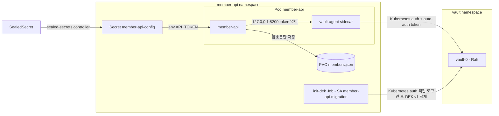

# Vault + Agent Injector로 암호화 키 전달하기

kind + ArgoCD 위에 HashiCorp Vault를 운영과 비슷하게 구성하고(Raft 스토리지, 수동 unseal, audit, snapshot), 회원 API(member-api)가 Pod에 주입된 Vault Agent를 거쳐 DEK(데이터 암호화 키)를 받아 개인정보를 암호화하는 예제다.

- **DEK**: Vault Transit KEK `member-api-kek`로 wrap해서 KV v2(`secret/member-api/dek`)에 둔다. 앱은 부팅할 때 받아 **메모리에만** 둔다. K8s Secret(etcd)에는 넣지 않는다
- **설정 시크릿**(API 토큰): SealedSecret이 만든 K8s Secret을 env로 받는다
- **앱의 Vault 접근**: Pod의 `vault-agent` sidecar가 Kubernetes auth로 로그인하고, 앱은 `http://127.0.0.1:8200`으로 token 없이 호출한다
- **DEK 적재**: ArgoCD Sync hook Job이 migration ServiceAccount로 Kubernetes auth에 직접 로그인해서 한다
- **3편**: 설정 시크릿을 SealedSecret에서 Vault Secrets Operator(VSO)로 옮긴다. Vault KV `secret/member-api/config`를 같은 이름의 Secret `member-api-config`로 동기화하므로 Deployment는 바뀌지 않는다(9단계부터)



## 구성

| 경로 | 내용 |
|---|---|
| `bootstrap/` | ArgoCD Application: `sealed-secrets`(chart 2.22.0), `vault`(chart 0.34.1, raft replica 1, `hashicorp/vault:2.2.1`), `member-api`, `vault-secrets-operator`(chart 1.6.2, 3편) |
| `scripts/vault-init.sh` | `vault operator init -key-shares=3 -key-threshold=2` → `.vault/init.json`. 이미 초기화돼 있으면 아무것도 쓰지 않는다 |
| `scripts/vault-unseal.sh` | `.vault/init.json`의 unseal key 2개로 unseal |
| `scripts/vault-setup.sh` | kv-v2, Transit, KEK, policy 3개, Kubernetes auth와 role 3개(`vso-member-api`는 3편), file audit(stdout). 다시 실행해도 결과가 같다 |
| `scripts/seal.sh` | API 토큰을 kubeseal로 봉인해 `charts/member-api/templates/sealedsecret.yaml`에 쓴다. `SKIP_OWNER_REFS=1`이면 Secret에 `skip-set-owner-references`와 `managed` 어노테이션을 넣는다(3편) |
| `scripts/snapshot.sh` | Raft snapshot 저장(`.vault/snapshots/`)과 복구 |
| `scripts/vault-config.sh` | 설정 시크릿(API 토큰)을 Vault KV `secret/member-api/config`에 쓴다(3편) |
| `scripts/set-param.sh` | member-api Application의 helm parameter 하나만 바꾼다(`load-mode`, `secret-source`가 쓴다) |
| `scripts/secret-source.sh` | `secretSource`를 `sealed`/`vault`로 바꾼다. 바꾸기 전에 Secret 소유자와 ArgoCD revision을 확인한다(3편) |
| `scripts/config-check.sh` | Secret과 Vault KV의 API 토큰이 같은지 sha256으로 비교한다(3편) |
| `charts/member-api/` | SA 2개·SealedSecret(wave -1) → DEK Job(Sync hook, wave 0) → Deployment·Service·PVC(wave 1). `secretSource: vault`면 SealedSecret 대신 VSO 리소스(wave -2·-1) |
| `app/member-api/` | Go 앱. `serve`(HTTP), `init-dek`(DEK 적재) |
| `vault/policies/` | `member-api`(DEK 읽기, unwrap), `member-api-migration`(DEK 발급·적재), `vso-member-api`(설정 시크릿 읽기, 3편) |

모든 kubectl·helm·kubeseal 명령은 `--context kind-argo-cluster`로만 보낸다. 그 context가 없으면 스크립트는 아무 명령도 보내지 않고 끝난다.

## 사전 준비

- Docker, kind, kubectl, helm, terraform(`../terraform`이 ArgoCD를 설치한다)
- kubeseal(0.41.x), jq
- `.vault/`에는 unseal key와 root token이 들어간다. gitignore되어 있으니 커밋하지 않는다
- **이 저장소를 fork해서 실습한다.** ArgoCD는 GitHub에서 chart를 가져오는데, chart에 커밋된 SealedSecret은 그것을 봉인한 클러스터의 sealed-secrets 키로만 풀린다. 내 클러스터에서 `make seal`로 다시 봉인한 파일을 내 fork에 push해야 member-api가 배포된다(4단계)

## 실행

### 1. 클러스터, ArgoCD, sealed-secrets, Vault

```bash
cd secret-management
make cluster      # kind 클러스터 + ArgoCD (../terraform)
make bootstrap    # sealed-secrets, vault Application
kubectl --context kind-argo-cluster -n vault get pods
```

```
NAME                                    READY   STATUS    RESTARTS   AGE
vault-0                                 0/1     Running   0          66s
vault-agent-injector-7cf96b9c79-rdwg9   1/1     Running   0          66s
```

`vault-0`이 `0/1`인 것은 아직 초기화와 unseal을 하지 않았기 때문이다(readinessProbe가 `vault status`를 본다).

### 2. init, unseal

```bash
make vault-init
make vault-unseal
make vault-status
```

```
initialized: unseal key 3개(threshold 2)와 root token 을 .../secret-management/.vault/init.json 에 저장했다
unsealed: sealed=false
Key                     Value
---                     -----
Seal Type               shamir
Initialized             true
Sealed                  false
Total Shares            3
Threshold               2
Version                 2.2.1
...
Storage Type            raft
...
HA Enabled              true
...
HA Mode                 active
...
```

`vault-0`을 지우면 Raft 데이터가 PVC에 남아 있으므로 초기화 상태는 유지되고, sealed 상태로 다시 뜬다.

```bash
kubectl --context kind-argo-cluster -n vault delete pod vault-0
kubectl --context kind-argo-cluster -n vault wait --for=jsonpath='{.status.phase}'=Running pod/vault-0 --timeout=120s
make vault-status | grep -E "Initialized|Sealed"
make vault-unseal
```

```
Initialized             true
Sealed                  true
unsealed: sealed=false
```

### 3. Vault 설정

```bash
make vault-setup
```

```
Success! Enabled the kv-v2 secrets engine at: secret/
Success! Enabled the transit secrets engine at: transit/
Transit KEK ready: member-api-kek
Success! Uploaded policy: member-api
Success! Uploaded policy: member-api-migration
Success! Enabled kubernetes auth method at: kubernetes/
Success! Data written to: auth/kubernetes/config
WARNING! The following warnings were returned from Vault:

  * Role member-api does not have an audience configured. While audiences are
  not required, consider specifying one if your use case would benefit from
  additional JWT claim verification.
...
Success! Enabled the file audit device at: file/
vault setup done
```

audience 경고는 role에 `audience`를 지정하지 않았다는 안내다. 이 예제는 Pod 기본 ServiceAccount token을 그대로 쓰므로 지정하지 않았다.

Kubernetes auth는 role에 묶인 ServiceAccount의 token으로만 로그인된다. 아직 member-api를 배포하기 전이므로 확인용 namespace와 ServiceAccount를 잠시 만든다.

```bash
kubectl --context kind-argo-cluster create namespace member-api
kubectl --context kind-argo-cluster -n member-api create serviceaccount member-api
kubectl --context kind-argo-cluster -n member-api create serviceaccount other

JWT=$(kubectl --context kind-argo-cluster -n member-api create token member-api)
kubectl --context kind-argo-cluster -n vault exec -i vault-0 -- vault write auth/kubernetes/login role=member-api jwt="$JWT"
```

```
Key                                       Value
---                                       -----
token                                     hvs.****
...
token_duration                            1h
...
token_policies                            ["default" "member-api"]
...
token_meta_role                           member-api
token_meta_service_account_name           member-api
token_meta_service_account_namespace      member-api
...
```

다른 ServiceAccount(`other`)의 token으로 같은 role에 로그인하면 거부된다.

```bash
JWT=$(kubectl --context kind-argo-cluster -n member-api create token other)
kubectl --context kind-argo-cluster -n vault exec -i vault-0 -- vault write auth/kubernetes/login role=member-api jwt="$JWT"
```

```
Error writing data to auth/kubernetes/login: Error making API request.

URL: PUT http://127.0.0.1:8200/v1/auth/kubernetes/login
Code: 403. Errors:

* service account name not authorized
```

확인이 끝나면 ServiceAccount를 지운다. member-api ServiceAccount는 4단계에서 chart가 만든다.

```bash
kubectl --context kind-argo-cluster -n member-api delete serviceaccount member-api other
```

### 4. member-api 배포

```bash
make seal          # API 토큰을 이 클러스터의 키로 봉인(기본값 demo-api-token-v1. 명령줄 API_TOKEN, .env 의 API_TOKEN 순으로 우선한다)
git add charts/member-api/templates/sealedsecret.yaml && git commit -m "member-api SealedSecret 다시 봉인" && git push
make app-image     # docker build + kind load
make app-deploy REPO=https://github.com/<내 계정>/argocd-charts-sample REVISION=<push 한 브랜치>
kubectl --context kind-argo-cluster -n member-api get jobs,pods
```

kind 클러스터를 다시 만들면 sealed-secrets 키도 새로 생기므로 `make seal`부터 다시 한다. 봉인을 다시 하지 않으면 Secret `member-api-config`가 만들어지지 않아 sync가 wave -1에서 멈춘다.

다음은 시나리오를 몇 번 돌린 뒤 sync했을 때의 출력이다.

```
NAME                                                    STATUS     COMPLETIONS   DURATION   AGE
job.batch/member-api-init-dek-5e557f8-sync-1793629711   Complete   1/1           3s         4s

NAME                                                    READY   STATUS      RESTARTS   AGE
pod/member-api-98c4f487-2fj9w                           2/2     Running     0          2m13s
pod/member-api-init-dek-5e557f8-sync-1793629711-mnmsz   0/1     Completed   0          4s
```

DEK Job은 `generateName`이라 sync마다 `member-api-init-dek-<리비전>-sync-<시각>` 이름으로 새로 만들어지고, 끝난 Job은 10분 뒤 지워진다. 처음 배포했을 때는 Job 로그에 `DEK v1 created`가 남는다.

```
DEK v1 created
```

Pod 구성과 앱 로그:

```bash
kubectl --context kind-argo-cluster -n member-api get pod -l app=member-api \
  -o jsonpath='init=[{.items[0].spec.initContainers[*].name}] containers=[{.items[0].spec.containers[*].name}]'
kubectl --context kind-argo-cluster -n member-api logs deploy/member-api -c member-api
```

```
init=[] containers=[member-api vault-agent]
time=2026-11-02T14:09:07.828Z level=INFO msg=listening addr=:8080 load_mode=async
time=2026-11-02T14:09:08.998Z level=INFO msg="keyring loaded" attempt=1 dek_version=1
```

`agent-pre-populate: "false"`라서 init container 없이 sidecar만 붙는다.

```bash
make app-port-forward   # 다른 터미널. localhost:8081 → member-api
curl -s localhost:8081/readyz
curl -s -X POST localhost:8081/members -d '{"id":"alice","email":"alice@example.com","phone":"010-1234-5678"}'
curl -s localhost:8081/members/alice
curl -s localhost:8081/config
kubectl --context kind-argo-cluster -n member-api exec deploy/member-api -c member-api -- cat /data/members.json
```

```
ready
{"id":"alice"}
{"id":"alice","email":"alice@example.com","phone":"010-1234-5678"}
{"api_token":"de****","length":17}
{
  "members": [
    {
      "id": "alice",
      "email": "AWAdLO+hsa5WvN+gx6nQ8VvpaRkHBHtI4A1f4ljtsP7Pn5rUT/AVBRT5IhHJfg==",
      "phone": "ATZQFpIogexu9CGs/CgDlqDF0SueuLeNHpPY10e2uBl/rv3ZBEUVpNpF"
    }
  ]
}
```

DEK Job은 sync마다 다시 돌지만 DEK를 덮어쓰지 않는다.

```bash
make app-sync && make init-dek-logs
```

```
job.batch/member-api-init-dek-5e557f8-sync-1793629183
DEK already exists, skipped
```

### 5. 부팅 블로킹 재현: `LOAD_MODE=sync`

`sync` 모드는 keyring을 받을 때까지 HTTP 서버를 띄우지 않는다. Vault가 sealed인 상태에서 앱이 뜨면 livenessProbe가 계속 실패한다.

```bash
make load-mode MODE=sync      # Vault 가 unseal 된 상태에서 바꾼다(sealed 면 DEK Job 이 실패해 sync 가 멈춘다)
make vault-seal
kubectl --context kind-argo-cluster -n member-api delete pod -l app=member-api
```

10초 간격으로 본 Pod 상태:

```
t=10s 1/2 Running restarts=0
t=20s 1/2 Running restarts=1
t=30s 1/2 Running restarts=2
t=40s 1/2 Running restarts=2
t=50s 1/2 Running restarts=3
t=60s 1/2 CrashLoopBackOff restarts=3
t=70s 1/2 CrashLoopBackOff restarts=3
t=80s 1/2 CrashLoopBackOff restarts=3
t=90s 1/2 Running restarts=4
t=100s 1/2 CrashLoopBackOff restarts=4
t=110s 1/2 CrashLoopBackOff restarts=4
```

```
Warning Unhealthy ... Liveness probe failed: Get "http://10.244.0.32:8080/healthz": dial tcp 10.244.0.32:8080: connect: connection refused
Normal Killing ... Container member-api failed liveness probe, will be restarted
```

vault-agent 로그:

```
  | Code: 503. Errors:
  | * Vault is sealed
   backoff=8.3s
```

unseal하면 다음 재시작에서 회복된다(CrashLoopBackOff 대기 시간만큼 늦다).

```
unsealed: sealed=false
t=10s 1/2 CrashLoopBackOff restarts=4
t=20s 1/2 CrashLoopBackOff restarts=4
t=30s 2/2 Running restarts=5
```

### 6. 해결: `LOAD_MODE=async`

`async` 모드는 HTTP 서버를 먼저 띄우고 keyring은 백그라운드에서 재시도한다. livenessProbe(`/healthz`)는 통과하고 readinessProbe(`/readyz`)만 실패하므로 Pod는 재시작되지 않고 트래픽만 받지 않는다.

```bash
make load-mode MODE=async
make vault-seal
kubectl --context kind-argo-cluster -n member-api delete pod -l app=member-api
make app-port-forward   # port-forward 는 시작할 때의 Pod 에 묶이므로 Pod 를 지운 뒤에는 다시 실행한다
```

```
NAME                        READY   STATUS    RESTARTS   AGE
member-api-98c4f487-86vcv   1/2     Running   0          28s

$ curl -s localhost:8081/readyz
{"error":"keyring not loaded"}            # 503
$ curl -s localhost:8081/members/alice
{"error":"keyring not loaded"}            # 503
$ curl -s localhost:8081/healthz
ok                                        # 200
```

```bash
make vault-unseal
```

unseal 후 7초 뒤 `/readyz`가 200이 됐다. 앱 로그:

```
level=WARN msg="keyring load failed, will retry" attempt=1 retry_in=1s error="... GET http://127.0.0.1:8200/v1/secret/data/member-api/dek\nCode: 403. Errors:\n\n* permission denied"
level=INFO msg="keyring loaded" attempt=2 dek_version=1
```

첫 요청은 unseal 직후 403으로 끝났다. Agent가 아직 로그인을 마치지 못해 token 없이 전달된 것으로 보이고, 1초 뒤 재시도에서 성공했다. 그래서 로드 실패를 한 번으로 끝내지 않고 재시도해야 한다. `auth-max-backoff`를 10s로 줄여 둔 것도 같은 이유다(기본값 5m이면 unseal 뒤 Agent가 최대 5분을 기다릴 수 있다).

### 7. Vault 재시작과 키 보존

```bash
kubectl --context kind-argo-cluster -n vault delete pod vault-0
kubectl --context kind-argo-cluster -n vault wait --for=jsonpath='{.status.phase}'=Running pod/vault-0 --timeout=120s
make vault-status | grep -E "Initialized|Sealed"
curl -s localhost:8081/members/alice           # Vault 가 sealed 여도 앱은 메모리의 keyring 으로 동작한다
make vault-unseal
kubectl --context kind-argo-cluster -n member-api delete pod -l app=member-api
kubectl --context kind-argo-cluster -n member-api wait --for=condition=Ready pod -l app=member-api --timeout=120s
make app-port-forward                          # 새 Pod 로 다시 연결한다
curl -s localhost:8081/members/alice           # 새 Pod 가 같은 KEK·DEK 로 옛 데이터를 읽는다
```

```
Initialized             true
Sealed                  true
{"id":"alice","email":"alice@example.com","phone":"010-1234-5678"}
unsealed: sealed=false
{"id":"alice","email":"alice@example.com","phone":"010-1234-5678"}
```

### 8. Raft snapshot

Transit KEK는 Vault 밖으로 꺼낼 수 없으므로 snapshot이 곧 KEK 백업이다. 복구하려면 같은 클러스터의 unseal key가 필요하니 `.vault/init.json`과 함께 보관한다.

```bash
make snapshot-save
# snapshot 이후에 값을 하나 쓴다
kubectl --context kind-argo-cluster -n vault exec -i vault-0 -- env VAULT_TOKEN="$(jq -r .root_token .vault/init.json)" \
  vault kv put secret/demo/after-snapshot note="snapshot 이후에 쓴 값"
make snapshot-restore SNAPSHOT=.vault/snapshots/vault-20261102232650.snap
```

```
saved: .vault/snapshots/vault-20261102232650.snap (69660 bytes)
restored: .vault/snapshots/vault-20261102232650.snap (Vault 로그에 'post-unseal setup complete' 가 나올 때까지 기다린다)
```

```
2026-11-02T14:26:51.776Z [INFO] storage.raft: restored user snapshot: index=217
2026-11-02T14:26:56.798Z [INFO] core: post-unseal setup complete
Sealed                  false
No value found at secret/data/demo/after-snapshot
```

snapshot 이후에 쓴 값은 사라지고, 그 전에 있던 DEK와 회원 데이터는 그대로다. 공식 문서는 복구 뒤 로그에 `post-unseal setup complete`와 `vault is unsealed`가 나온 것을 확인하고 작업을 재개하라고 한다. 이 실습은 같은 클러스터의 snapshot이라 unseal 상태가 유지되어 `post-unseal setup complete`만 다시 기록됐다.

## 3편: SealedSecret에서 Vault Secrets Operator로

명령 아래의 출력은 이 kind 클러스터에서 실제로 실행한 결과다. `...`는 생략한 부분이다. "관찰 스크립트 출력"이라고 적은 블록은 상태를 일정 간격으로 찍는 셸 루프의 출력이다. 10~16단계(이전 절차)는 두 번 실행했다. 처음 실행에서 찾은 문제(11단계의 `managed`, 13단계의 `_raw`)를 고친 뒤 처음부터 다시 실행했고, 처음 실행 때의 출력에는 그렇다고 밝혀 두었다.

### 9. VSO 설치와 Vault 준비

```bash
make bootstrap-vso    # vault-secrets-operator Application
make vault-setup      # policy·role vso-member-api 추가
make vault-config     # API 토큰을 secret/member-api/config 에 쓴다
kubectl --context kind-argo-cluster -n vault-secrets-operator-system get pods
```

```
$ make vault-setup
Transit KEK ready: member-api-kek
Success! Uploaded policy: member-api
Success! Uploaded policy: member-api-migration
Success! Uploaded policy: vso-member-api
Success! Data written to: auth/kubernetes/config
vault setup done

$ make vault-config
======== Secret Path ========
secret/data/member-api/config
...
version            1

$ kubectl --context kind-argo-cluster -n vault-secrets-operator-system get pods
NAME                                                         READY   STATUS    RESTARTS   AGE
vault-secrets-operator-controller-manager-66b974986f-fsn6p   2/2     Running   0          32s
```

`make vault-config`와 `make seal`은 같은 규칙으로 API 토큰 값을 정한다. 명령줄의 `API_TOKEN`이 먼저고, 없으면 `.env`의 `API_TOKEN`, 그것도 없으면 `demo-api-token-v1`이다. 두 명령 모두 값 대신 sha256 앞 12자리(`api-token sha256=...`)를 출력하므로 두 곳에 같은 값을 넣었는지 비교할 수 있다. 위 `make vault-config` 출력은 이 sha256 출력을 넣기 전에 실행한 것이다.

VSO Application에는 `ServerSideApply=true`를 쓰지 않는다. 처음에 켰을 때 ArgoCD v2.14.11이 Kubernetes 1.37 Deployment의 새 status 필드(`.status.terminatingReplicas`)를 스키마에서 찾지 못해 비교에 실패했다.

```
$ kubectl --context kind-argo-cluster -n argocd get application vault-secrets-operator -o json | jq '{sync: .status.sync.status, health: .status.health.status, conditions: [.status.conditions[]? | {type, message: (.message|tostring|.[0:400])}], op: .status.operationState.phase, opmsg: (.status.operationState.message // "" | .[0:300])}'
{
  "sync": "Unknown",
  "health": "Healthy",
  "conditions": [
    {
      "type": "ComparisonError",
      "message": "Failed to compare desired state to live state: failed to calculate diff: error calculating structured merge diff: error building typed value from live resource: .status.terminatingReplicas: field not declared in schema"
    }
  ],
  "op": "Succeeded",
  "opmsg": "successfully synced (all tasks run)"
}
```

옵션을 빼고 CRD까지 지운 뒤 처음부터 다시 설치하면 `Synced/Healthy`가 된다.

`vso-member-api` role은 설정 시크릿만 읽을 수 있다. ServiceAccount `vso-member-api`는 12단계에서 chart가 만들므로, 확인할 때는 잠시 만들었다가 지운다.

```bash
kubectl --context kind-argo-cluster -n member-api create serviceaccount vso-member-api
JWT=$(kubectl --context kind-argo-cluster -n member-api create token vso-member-api)
OUT=$(kubectl --context kind-argo-cluster -n vault exec -i vault-0 -- vault write -format=json auth/kubernetes/login role=vso-member-api jwt="$JWT")
echo "$OUT" | jq -c '{policies: .auth.policies, ttl: .auth.lease_duration, sa: .auth.metadata.service_account_name}'
VSO_TOKEN=$(echo "$OUT" | jq -r .auth.client_token)
kubectl --context kind-argo-cluster -n vault exec -i vault-0 -- env VAULT_TOKEN=$VSO_TOKEN vault kv get -field=api-token secret/member-api/config
kubectl --context kind-argo-cluster -n vault exec -i vault-0 -- env VAULT_TOKEN=$VSO_TOKEN vault kv get secret/member-api/dek
kubectl --context kind-argo-cluster -n member-api delete serviceaccount vso-member-api
```

```
{"policies":["default","vso-member-api"],"ttl":3600,"sa":"vso-member-api"}
demo-api-token-v1
Code: 403. Errors:
	* permission denied
```

### 10. 왜 바로 바꾸면 안 되는가

SealedSecret이 만든 Secret에는 SealedSecret을 가리키는 ownerReference가 있다.

```bash
kubectl --context kind-argo-cluster -n member-api get secret member-api-config -o json \
  | jq -c '{uid: .metadata.uid, ownerReferences: [.metadata.ownerReferences[]? | {kind, controller}], annotations: (.metadata.annotations // {} | keys)}'
```

```
{"uid":"d1c50c29-2753-4090-b810-d0dad61122c7","ownerReferences":[{"kind":"SealedSecret","controller":true}],"annotations":[]}
```

그래서 SealedSecret을 지우면 Kubernetes GC가 Secret도 지운다. 처음 실행 때 별도 namespace에서 확인한 결과:

```
$ kubectl --context kind-argo-cluster -n sealed-demo get secret demo-config -o jsonpath="{.metadata.ownerReferences[0].kind} controller={.metadata.ownerReferences[0].controller}"
SealedSecret controller=true
$ kubectl --context kind-argo-cluster -n sealed-demo delete sealedsecret demo-config
sealedsecret.bitnami.com "demo-config" deleted from sealed-demo namespace
$ kubectl --context kind-argo-cluster -n sealed-demo get secret demo-config
Error from server (NotFound): secrets "demo-config" not found
```

`secretSource`를 바로 `vault`로 바꾸면 ArgoCD가 SealedSecret을 prune하면서 Secret이 지워질 수 있다. 그래서 두 단계로 옮긴다. `make secret-source SOURCE=vault`는 Secret에 SealedSecret ownerReference가 남아 있으면 parameter를 바꾸지 않고 멈춘다.

```
$ make secret-source SOURCE=vault; echo "exit=$?"
./scripts/secret-source.sh vault
error: Secret member-api-config 를 아직 SealedSecret 이 소유하고 있다. 먼저 SKIP_OWNER_REFS=1 make seal → commit·push → make app-sync 로 소유 관계를 끊는다.
make: *** [secret-source] Error 1
exit=2
```

### 11. 1단계: 소유 관계 끊기

`SKIP_OWNER_REFS=1 make seal`은 봉인할 Secret에 어노테이션 두 개를 넣는다.

- `sealedsecrets.bitnami.com/skip-set-owner-references: "true"`: 컨트롤러가 ownerReference를 붙이지 않는다. SealedSecret을 지워도 Secret이 남는다
- `sealedsecrets.bitnami.com/managed: "true"`: ownerReference가 없어도 컨트롤러가 이 Secret을 계속 관리한다

두 번째가 빠지면 안 된다. 컨트롤러는 Secret이 자기 소유(ownerReference)가 아니고 `managed` 어노테이션도 없으면 갱신을 거부한다. skip만 넣고 봉인한 SealedSecret으로 롤백(14단계)했을 때의 결과:

```
$ kubectl --context kind-argo-cluster -n member-api get sealedsecret member-api-config -o jsonpath='{range .status.conditions[*]}{.type}={.status} {.message}{"\n"}{end}'
Synced=False failed update: Resource "member-api-config" already exists and is not managed by SealedSecret

$ kubectl --context kind-argo-cluster -n argocd get application member-api -o jsonpath='{.status.sync.status}/{.status.health.status}'
Synced/Degraded
```

봉인할 값은 지금 Secret에 들어 있는 값이다. `make config-check`로 Secret과 Vault의 값이 같은지 먼저 본다. 이 실습에서는 그 sha256(`f7f38d53815f`)이 `make seal`의 출력과 같았다.

```bash
make config-check
SKIP_OWNER_REFS=1 API_TOKEN=demo-api-token-v3 make seal
git add charts/member-api/templates/sealedsecret.yaml && git commit -m "..." && git push
# ArgoCD 가 새 커밋을 바로 읽게 한다
kubectl --context kind-argo-cluster -n argocd annotate application member-api argocd.argoproj.io/refresh=hard --overwrite
kubectl --context kind-argo-cluster -n argocd get application member-api -o jsonpath='{.status.sync.revision}' | cut -c1-7
kubectl --context kind-argo-cluster -n member-api get sealedsecret member-api-config -o jsonpath='{range .status.conditions[*]}{.type}={.status}{end}'
kubectl --context kind-argo-cluster -n member-api get secret member-api-config -o json \
  | jq -c '{uid: .metadata.uid, ownerReferences: [.metadata.ownerReferences[]? | {kind, controller}], annotations: (.metadata.annotations // {} | keys)}'
kubectl --context kind-argo-cluster -n argocd get application member-api -o jsonpath='{.status.sync.status}/{.status.health.status}'
```

```
match: secret=f7f38d53815f vault=f7f38d53815f
sealed: .../charts/member-api/templates/sealedsecret.yaml (api-token sha256=f7f38d53815f)
...
a8fad0a
Synced=True
{"uid":"d1c50c29-2753-4090-b810-d0dad61122c7","ownerReferences":[],"annotations":["sealedsecrets.bitnami.com/managed","sealedsecrets.bitnami.com/skip-set-owner-references"]}
Synced/Healthy
```

uid는 그대로이고 ownerReference만 사라졌다. 이제 SealedSecret을 지워도 Secret은 남는다.

**이미 Degraded가 됐다면** 남아 있는 Secret에 `managed`를 달고 sealed-secrets controller를 재시작한다. 이 실습에서는 이전 전 상태로 되돌리려고 `SKIP_OWNER_REFS` 없이 다시 봉인해 push한 뒤 아래 명령을 실행했다.

```bash
kubectl --context kind-argo-cluster -n member-api annotate secret member-api-config sealedsecrets.bitnami.com/managed=true
kubectl --context kind-argo-cluster -n kube-system rollout restart deploy/sealed-secrets-controller
```

어노테이션만 달고 sync하거나 SealedSecret에 임의의 어노테이션을 붙여 봐도 `Synced=False`가 그대로였다. controller 로그를 보면 실패한 항목은 `Error updating, giving up`으로 끝났고, 메타데이터만 바뀐 SealedSecret은 `update suppressed, no changes in spec`으로 넘어갔다. controller를 재시작하자 `Synced=True`가 되었고 ownerReference가 다시 붙었다.

```
$ kubectl --context kind-argo-cluster -n member-api get sealedsecret member-api-config -o jsonpath='{range .status.conditions[*]}{.type}={.status} {.message}{end}'
Synced=True 
$ kubectl --context kind-argo-cluster -n member-api get secret member-api-config -o json | jq -c '{uid: .metadata.uid, ownerReferences: [.metadata.ownerReferences[]? | {kind, controller}], annotations: (.metadata.annotations // {} | keys)}'
{"uid":"d1c50c29-2753-4090-b810-d0dad61122c7","ownerReferences":[{"kind":"SealedSecret","controller":true}],"annotations":[]}
$ kubectl --context kind-argo-cluster -n argocd get application member-api -o jsonpath='{.status.sync.status}/{.status.health.status} {.status.operationState.phase}'
Synced/Healthy Succeeded
```

### 12. 2단계: VSO로 전환

```bash
make config-check
make secret-source SOURCE=vault
kubectl --context kind-argo-cluster -n member-api get sealedsecret,vaultstaticsecret
kubectl --context kind-argo-cluster -n member-api get secret member-api-config -o json \
  | jq -c '{uid: .metadata.uid, ownerReferences: [.metadata.ownerReferences[]? | {kind, controller}], managedBy: .metadata.labels["app.kubernetes.io/managed-by"], annotations: (.metadata.annotations // {} | keys), keys: (.data | keys)}'
make config-check
kubectl --context kind-argo-cluster -n member-api get pod -l app=member-api
kubectl --context kind-argo-cluster -n argocd get application member-api -o jsonpath='{.status.sync.status}/{.status.health.status}'
```

```
match: secret=f7f38d53815f vault=f7f38d53815f
./scripts/secret-source.sh vault
helm parameters: [{"name":"loadMode","value":"async"},{"name":"secretSource","value":"vault"}]

NAME                                                        SYNCED   HEALTHY   READY   AGE
vaultstaticsecret.secrets.hashicorp.com/member-api-config   True     True      True    22s

{"uid":"d1c50c29-2753-4090-b810-d0dad61122c7","ownerReferences":[{"kind":"VaultStaticSecret","controller":null}],"managedBy":"hashicorp-vso","annotations":[],"keys":["api-token"]}
match: secret=f7f38d53815f vault=f7f38d53815f

NAME                          READY   STATUS    RESTARTS   AGE
member-api-57978f9cbb-5pwr6   2/2     Running   0          48m
Synced/Healthy
```

SealedSecret은 prune됐고, VaultStaticSecret이 `destination.overwrite: true`로 **같은 Secret(uid 그대로)**을 넘겨받았다. ownerReference와 label은 VSO 것으로 바뀌었고, 1단계에서 넣은 두 어노테이션은 사라졌다. VSO는 첫 동기화에서는 Deployment를 재시작하지 않으므로 앱 Pod도 그대로다. 처음 실행했을 때 전환 뒤 2분 동안 Secret의 `resourceVersion`이 바뀌지 않았고, sealed-secrets controller 로그에도 이 Secret에 대한 기록이 없었다. 두 컨트롤러가 같은 Secret을 번갈아 덮어쓰지 않는다.

VaultConnection·VaultAuth·SA는 VaultStaticSecret보다 앞 wave(-2)에 둔다. 처음에 같은 wave(-1)에 두었을 때는 VaultStaticSecret이 먼저 처리되어 경고 2건이 난 뒤 동기화됐다.

```
$ kubectl --context kind-argo-cluster -n member-api get events --field-selector involvedObject.kind=VaultStaticSecret
LAST SEEN   TYPE      REASON                   OBJECT                                MESSAGE
14s         Warning   Unrecoverable            vaultstaticsecret/member-api-config   Failed to get cacheKey from obj, err=VaultConnection.secrets.hashicorp.com "vault" not found
14s         Warning   VaultClientConfigError   vaultstaticsecret/member-api-config   Failed to get Vault auth login: VaultConnection.secrets.hashicorp.com "vault" not found
14s         Normal    SecretSynced             vaultstaticsecret/member-api-config   Secret synced
```

### 13. 값 변경과 재시작

VaultStaticSecret은 `refreshAfter`(30s)마다 KV를 다시 읽는다. VSO 1.6.2 소스(`controllers/vaultstaticsecret_controller.go`)를 보면 다음 경우에 Secret을 다시 쓰고, 첫 동기화가 아니면 `rolloutRestartTargets`의 Deployment를 재시작한다.

- Vault에서 읽은 값의 HMAC이 지난번과 다르다
- Secret을 누가 직접 고쳐서 Vault 값과 달라졌다(drift)
- VaultStaticSecret의 spec이 바뀌었다(`metadata.generation`)

`destination.transformation.excludeRaw: true`를 켠 이유가 있다(처음 실행 때의 기록이다). VSO는 기본으로 KV 응답 전체를 Secret의 `_raw` 키에 넣는데, 여기에 KV의 버전이 들어 있다. 켜기 전에는 같은 값을 다시 `kv put`해도 버전만 바뀌어 Deployment가 재시작됐다.

```
$ kubectl --context kind-argo-cluster -n member-api get secret member-api-config -o json | jq -r '.data | keys | join(", ")'
_raw, api-token
$ kubectl --context kind-argo-cluster -n member-api get secret member-api-config -o jsonpath='{.data._raw}' | base64 -d | jq -c '{keys, metadata, data_keys: (.data|keys)}'
{"keys":["data","metadata"],"metadata":{"created_time":"2026-11-03T07:54:52.774009293Z","custom_metadata":null,"deletion_time":"","destroyed":false,"version":3},"data_keys":["api-token"]}
```

켠 뒤에 root token으로 같은 값과 다른 값을 차례로 넣어 보았다.

```bash
ROOT_TOKEN=$(jq -r .root_token .vault/init.json)
vkv() { kubectl --context kind-argo-cluster -n vault exec -i vault-0 -- env VAULT_TOKEN="$ROOT_TOKEN" vault kv "$@"; }
vkv put secret/member-api/config api-token=demo-api-token-v2-rotated   # 지금 값과 같은 값
vkv put secret/member-api/config api-token=demo-api-token-v3           # 다른 값
```

`kv put` 출력(`version`)과 관찰 스크립트 출력(`secretRV`는 Secret의 resourceVersion, `keys`는 Secret의 키):

```
t=0s restartedAt=2026-11-03T07:57:40Z secretRV=116541 keys=api-token pod=member-api-74fd874c58-tdnhg
version            4
t=70s restartedAt=2026-11-03T07:57:40Z secretRV=116541 keys=api-token pod=member-api-74fd874c58-tdnhg

version            5
t=10s restartedAt=2026-11-03T07:59:46Z secretRV=116880 keys=api-token pod=member-api-57978f9cbb-5pwr6
...
```

같은 값(version 4)에서는 70초 동안 Secret도 Deployment도 바뀌지 않았고, 다른 값(version 5)에서는 재시작됐다. 첫 줄의 `restartedAt` 07:57:40은 excludeRaw를 적용하면서 생긴 재시작이다. spec이 바뀌었고 Secret에서 `_raw` 키가 빠졌기 때문이다.

그 뒤 길이가 다른 값으로 바꿨다. 그래야 앱이 새 값을 읽었는지 `/config`의 `length`로 구분할 수 있다(`demo-api-token-v3`는 17자, `demo-api-token-v4-migrated`는 26자).

```bash
API_TOKEN=demo-api-token-v4-migrated make vault-config 2>&1 | grep -E 'version|sha256'
```

```
version            6
api-token sha256=e68536f2c1f6
```

관찰 스크립트 출력(30초 간격, Deployment의 `vso.secrets.hashicorp.com/restartedAt`와 Running Pod):

```
t=30s restartedAt=2026-11-03T08:48:39Z pod=member-api-7656c77bc7-nbb8x
t=60s restartedAt=2026-11-03T08:48:39Z pod=member-api-7656c77bc7-nbb8x
t=90s restartedAt=2026-11-03T08:48:39Z pod=member-api-7656c77bc7-nbb8x
```

```bash
make config-check
make app-port-forward   # 다른 터미널. 재시작으로 Pod 가 바뀌었으므로 다시 연결한다
curl -s localhost:8081/config
```

```
match: secret=e68536f2c1f6 vault=e68536f2c1f6
{"api_token":"de****","length":26}
```

Deployment는 RWO PVC 때문에 `Recreate`, replicas 1이다. 옛 Pod가 내려간 뒤 새 Pod가 뜨므로 값이 바뀔 때마다 잠깐 요청을 받지 못한다.

### 14. 롤백

SealedSecret에는 봉인할 때의 값이 들어 있다. 13단계처럼 Vault에서 값을 바꾼 뒤라면 **지금 값으로 다시 봉인**해야 옛 값으로 돌아가지 않는다. `make seal`이 출력한 sha256이 `make config-check`의 값(`e68536f2c1f6`)과 같은지 확인하고 push한다. 나중에 다시 VSO로 넘길 수 있도록 이번에도 `SKIP_OWNER_REFS=1`로 봉인한다.

```bash
SKIP_OWNER_REFS=1 API_TOKEN=demo-api-token-v4-migrated make seal
git add charts/member-api/templates/sealedsecret.yaml && git commit -m "..." && git push
kubectl --context kind-argo-cluster -n argocd annotate application member-api argocd.argoproj.io/refresh=hard --overwrite
make secret-source SOURCE=sealed
```

```
sealed: .../charts/member-api/templates/sealedsecret.yaml (api-token sha256=e68536f2c1f6)
...
./scripts/secret-source.sh sealed
helm parameters: [{"name":"loadMode","value":"async"},{"name":"secretSource","value":"sealed"}]
```

`make secret-source SOURCE=sealed`는 로컬 HEAD, 원격 브랜치, ArgoCD가 sync한 revision(`status.sync.revision`)이 모두 같을 때만 parameter를 바꾼다. 다시 봉인한 커밋을 ArgoCD가 아직 보지 못했다면 옛 SealedSecret으로 돌아가기 때문이다.

관찰 스크립트 출력(1초 간격, 바뀔 때만 기록):

```
t=1s uid=d1c50c29 owner=VaultStaticSecret | sealedsecret=0 vss=1
t=2s Secret 없음 | sealedsecret=0 vss=0
t=5s uid=0cb57244 owner= | sealedsecret=1 vss=0
```

```
$ kubectl --context kind-argo-cluster -n member-api get sealedsecret member-api-config -o jsonpath='{range .status.conditions[*]}{.type}={.status} {.message}{end}'
Synced=True 
$ kubectl --context kind-argo-cluster -n member-api get secret member-api-config -o json | jq -c '{uid: .metadata.uid, ownerReferences: [.metadata.ownerReferences[]?.kind], annotations: (.metadata.annotations // {} | keys)}'
{"uid":"0cb57244-7c43-4bb1-8cea-0583fa372b0f","ownerReferences":[],"annotations":["sealedsecrets.bitnami.com/managed","sealedsecrets.bitnami.com/skip-set-owner-references"]}

$ kubectl --context kind-argo-cluster -n argocd get application member-api -o jsonpath='{.status.sync.status}/{.status.health.status}'
Synced/Healthy
$ make config-check
./scripts/config-check.sh
match: secret=e68536f2c1f6 vault=e68536f2c1f6

$ kubectl --context kind-argo-cluster -n member-api get pod -l app=member-api
NAME                          READY   STATUS    RESTARTS   AGE
member-api-7656c77bc7-nbb8x   2/2     Running   0          5m28s
```

VaultStaticSecret이 prune되면서 그것이 소유한 Secret이 GC로 지워졌고, 약 3초 뒤 sealed-secrets가 새로 만들었다(uid가 바뀜). 실행 중인 Pod는 env를 이미 읽었으므로 재시작하지 않았지만, 그 몇 초 사이에 새로 뜨는 Pod는 Secret을 찾지 못한다.

다시 `make secret-source SOURCE=vault`로 바꾸면 VSO가 새 Secret을 넘겨받는다.

```
$ kubectl --context kind-argo-cluster -n member-api get secret member-api-config -o json | jq -c '{uid: .metadata.uid, ownerReferences: [.metadata.ownerReferences[]?.kind], managedBy: .metadata.labels["app.kubernetes.io/managed-by"], annotations: (.metadata.annotations // {} | keys)}'
{"uid":"0cb57244-7c43-4bb1-8cea-0583fa372b0f","ownerReferences":["VaultStaticSecret"],"managedBy":"hashicorp-vso","annotations":[]}

$ make config-check
./scripts/config-check.sh
match: secret=e68536f2c1f6 vault=e68536f2c1f6
```

`secretSource`는 member-api Application의 helm parameter에만 있다. Application을 지우고 다시 만들면 parameter가 사라져 기본값 `sealed`로 돌아가고, 그때 git에 있는 SealedSecret의 값으로 롤백된다.

### 15. Vault 장애

```
$ make vault-seal
./scripts/vault-seal.sh
Success! Vault is sealed.

$ sleep 60

$ kubectl --context kind-argo-cluster -n member-api get vaultstaticsecret member-api-config -o jsonpath='{range .status.conditions[*]}{.type}={.status} {end}'
SecretSynced=False Healthy=False Ready=False 
$ kubectl --context kind-argo-cluster -n member-api get events --field-selector involvedObject.kind=VaultStaticSecret,type=Warning --sort-by=.lastTimestamp -o custom-columns=REASON:.reason,MESSAGE:.message | tail -1 | cut -c1-120
* Vault is sealed

$ kubectl --context kind-argo-cluster -n member-api get secret member-api-config
NAME                TYPE     DATA   AGE
member-api-config   Opaque   1      2m40s

$ curl -s localhost:8081/config
{"api_token":"de****","length":26}

$ kubectl --context kind-argo-cluster -n argocd get application member-api -o jsonpath='{.status.sync.status}/{.status.health.status}'
Synced/Healthy
$ make vault-unseal
./scripts/vault-unseal.sh
unsealed: sealed=false

$ sleep 10; kubectl --context kind-argo-cluster -n member-api get vaultstaticsecret member-api-config -o jsonpath='{range .status.conditions[*]}{.type}={.status} {end}'
SecretSynced=True Healthy=True Ready=True 
```

Vault가 sealed여도 VSO는 Secret을 지우지 않고 마지막 값을 둔다. Secret의 AGE가 짧은 것은 14단계 롤백에서 새로 만들어졌기 때문이다. ArgoCD v2.14.11에는 VaultStaticSecret health check가 없어서, 동기화가 실패하는 동안에도 Application은 `Synced/Healthy`로 보인다.

### 16. audit log: 누가 무엇을 했나

```bash
kubectl --context kind-argo-cluster -n vault logs vault-0 --since=30m | grep '^{' \
  | jq -r 'select(.type=="request" and (.request.path|test("^secret/data/member-api/(config|dek)$"))) | "\(.request.path) \(.request.operation) \(.auth.display_name) \(.request.headers["user-agent"][0] // "-")"' \
  | sort | uniq -c
```

```
  34 secret/data/member-api/config read kubernetes-member-api-vso-member-api vso/1.6.2
   7 secret/data/member-api/config read root Go-http-client/1.1
   1 secret/data/member-api/config update root Go-http-client/1.1
   1 secret/data/member-api/dek read kubernetes-member-api-member-api Vault Agent API Proxy/2.2.1 (+https://www.vaultproject.io/; go1.27.3); Go-http-client/1.1
   5 secret/data/member-api/dek read kubernetes-member-api-member-api-migration Go-http-client/1.1
```

- 설정 시크릿은 VSO가 `vso-member-api` SA로 읽는다. VaultStaticSecret이 있는 동안 30초마다 읽는다. 이 30분에는 재실행과 롤백으로 sealed 모드였던 시간이 섞여 있어 34번이다
- `root`의 read는 `make config-check`가 비교하려고 읽은 것이고, update는 13단계의 `make vault-config`(`kv put`)다
- DEK는 앱이 Agent proxy를 거쳐 `member-api` SA로, sync마다 도는 DEK 적재 Job이 `member-api-migration` SA로 읽는다

Vault audit에 남는 것은 Vault에 직접 요청한 주체다. 설정 시크릿의 경우 VSO가 값을 가져간 기록과 관리자가 값을 바꾼 기록이 남는다. Pod가 env로 받거나 누가 `kubectl get secret`으로 Secret을 읽는 것은 Kubernetes API에 대한 접근이므로, SealedSecret을 쓰든 VSO를 쓰든 Kubernetes API audit log를 켜야 보인다.

## 정리

```bash
make -C ../terraform kind-delete
rm -rf .vault .helm
```

## 다루지 않는 것

- **HA**: 샘플 kind는 노드가 1개라 Raft replica를 1로 뒀다. 운영에서는 3대 이상으로 구성한다
- **auto-unseal**: 클라우드 KMS 등이 필요하다. 이 예제는 Shamir 수동 unseal이다
- **TLS**: chart 기본값(`tls_disable = 1`)을 그대로 썼다. 운영에서는 필수다
- **root token 회수**: 실습 편의상 `.vault/init.json`에 남겨 둔다. 운영에서는 초기 설정 후 revoke한다
- **VaultStaticSecret health check**: ArgoCD v2.14.11에는 내장 health check가 없다. 필요하면 `resource.customizations.health.secrets.hashicorp.com_VaultStaticSecret`로 직접 추가한다
- **instant update**: VSO의 이벤트 기반 즉시 갱신은 Vault Enterprise 기능이다. 이 예제는 `refreshAfter` 주기 갱신만 쓴다
- **동적 시크릿(VaultDynamicSecret)**: 다루지 않는다
