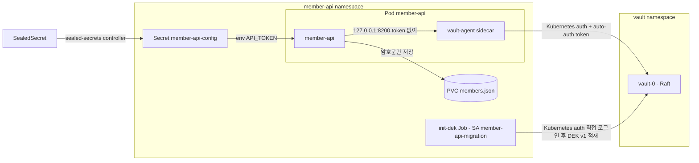

# Vault + Agent Injector로 암호화 키 전달하기

kind + ArgoCD 위에 HashiCorp Vault를 운영과 비슷하게 구성하고(Raft 스토리지, 수동 unseal, audit, snapshot), 회원 API(member-api)가 Pod에 주입된 Vault Agent를 거쳐 DEK(데이터 암호화 키)를 받아 개인정보를 암호화하는 예제다.

- **DEK**: Vault Transit KEK `member-api-kek`로 wrap해서 KV v2(`secret/member-api/dek`)에 둔다. 앱은 부팅할 때 받아 **메모리에만** 둔다. K8s Secret(etcd)에는 넣지 않는다
- **설정 시크릿**(API 토큰): SealedSecret이 만든 K8s Secret을 env로 받는다
- **앱의 Vault 접근**: Pod의 `vault-agent` sidecar가 Kubernetes auth로 로그인하고, 앱은 `http://127.0.0.1:8200`으로 token 없이 호출한다
- **DEK 적재**: ArgoCD Sync hook Job이 migration ServiceAccount로 Kubernetes auth에 직접 로그인해서 한다



## 구성

| 경로 | 내용 |
|---|---|
| `bootstrap/` | ArgoCD Application: `sealed-secrets`(chart 2.22.0), `vault`(chart 0.34.1, raft replica 1, `hashicorp/vault:2.2.1`), `member-api` |
| `scripts/vault-init.sh` | `vault operator init -key-shares=3 -key-threshold=2` → `.vault/init.json`. 이미 초기화돼 있으면 아무것도 쓰지 않는다 |
| `scripts/vault-unseal.sh` | `.vault/init.json`의 unseal key 2개로 unseal |
| `scripts/vault-setup.sh` | kv-v2, Transit, KEK, policy 2개, Kubernetes auth와 role 2개, file audit(stdout). 다시 실행해도 결과가 같다 |
| `scripts/seal.sh` | API 토큰을 kubeseal로 봉인해 `charts/member-api/templates/sealedsecret.yaml`에 쓴다 |
| `scripts/snapshot.sh` | Raft snapshot 저장(`.vault/snapshots/`)과 복구 |
| `charts/member-api/` | SA 2개·SealedSecret(wave -1) → DEK Job(Sync hook, wave 0) → Deployment·Service·PVC(wave 1) |
| `app/member-api/` | Go 앱. `serve`(HTTP), `init-dek`(DEK 적재) |
| `vault/policies/` | `member-api`(DEK 읽기, unwrap), `member-api-migration`(DEK 발급·적재) |

모든 kubectl·helm·kubeseal 명령은 `--context kind-argo-cluster`로만 보낸다. 그 context가 없으면 스크립트는 아무 명령도 보내지 않고 끝난다.

## 사전 준비

- Docker, kind, kubectl, helm, terraform(`../terraform`이 ArgoCD를 설치한다)
- kubeseal(0.41.x), jq
- `.vault/`에는 unseal key와 root token이 들어간다. gitignore되어 있으니 커밋하지 않는다
- **이 저장소를 fork해서 실습한다.** ArgoCD는 GitHub에서 chart를 가져오는데, chart에 커밋된 SealedSecret은 그것을 봉인한 클러스터의 sealed-secrets 키로만 풀린다. 내 클러스터에서 `make seal`로 다시 봉인한 파일을 내 fork에 push해야 member-api가 배포된다(4단계)

## 실행

### 1. 클러스터, ArgoCD, sealed-secrets, Vault

```bash
cd secret-management
make cluster      # kind 클러스터 + ArgoCD (../terraform)
make bootstrap    # sealed-secrets, vault Application
kubectl --context kind-argo-cluster -n vault get pods
```

```
NAME                                    READY   STATUS    RESTARTS   AGE
vault-0                                 0/1     Running   0          66s
vault-agent-injector-7cf96b9c79-rdwg9   1/1     Running   0          66s
```

`vault-0`이 `0/1`인 것은 아직 초기화와 unseal을 하지 않았기 때문이다(readinessProbe가 `vault status`를 본다).

### 2. init, unseal

```bash
make vault-init
make vault-unseal
make vault-status
```

```
initialized: unseal key 3개(threshold 2)와 root token 을 .../secret-management/.vault/init.json 에 저장했다
unsealed: sealed=false
Key                     Value
---                     -----
Seal Type               shamir
Initialized             true
Sealed                  false
Total Shares            3
Threshold               2
Version                 2.2.1
...
Storage Type            raft
...
HA Enabled              true
...
HA Mode                 active
...
```

`vault-0`을 지우면 Raft 데이터가 PVC에 남아 있으므로 초기화 상태는 유지되고, sealed 상태로 다시 뜬다.

```bash
kubectl --context kind-argo-cluster -n vault delete pod vault-0
kubectl --context kind-argo-cluster -n vault wait --for=jsonpath='{.status.phase}'=Running pod/vault-0 --timeout=120s
make vault-status | grep -E "Initialized|Sealed"
make vault-unseal
```

```
Initialized             true
Sealed                  true
unsealed: sealed=false
```

### 3. Vault 설정

```bash
make vault-setup
```

```
Success! Enabled the kv-v2 secrets engine at: secret/
Success! Enabled the transit secrets engine at: transit/
Transit KEK ready: member-api-kek
Success! Uploaded policy: member-api
Success! Uploaded policy: member-api-migration
Success! Enabled kubernetes auth method at: kubernetes/
Success! Data written to: auth/kubernetes/config
WARNING! The following warnings were returned from Vault:

  * Role member-api does not have an audience configured. While audiences are
  not required, consider specifying one if your use case would benefit from
  additional JWT claim verification.
...
Success! Enabled the file audit device at: file/
vault setup done
```

audience 경고는 role에 `audience`를 지정하지 않았다는 안내다. 이 예제는 Pod 기본 ServiceAccount token을 그대로 쓰므로 지정하지 않았다.

Kubernetes auth는 role에 묶인 ServiceAccount의 token으로만 로그인된다. 아직 member-api를 배포하기 전이므로 확인용 namespace와 ServiceAccount를 잠시 만든다.

```bash
kubectl --context kind-argo-cluster create namespace member-api
kubectl --context kind-argo-cluster -n member-api create serviceaccount member-api
kubectl --context kind-argo-cluster -n member-api create serviceaccount other

JWT=$(kubectl --context kind-argo-cluster -n member-api create token member-api)
kubectl --context kind-argo-cluster -n vault exec -i vault-0 -- vault write auth/kubernetes/login role=member-api jwt="$JWT"
```

```
Key                                       Value
---                                       -----
token                                     hvs.****
...
token_duration                            1h
...
token_policies                            ["default" "member-api"]
...
token_meta_role                           member-api
token_meta_service_account_name           member-api
token_meta_service_account_namespace      member-api
...
```

다른 ServiceAccount(`other`)의 token으로 같은 role에 로그인하면 거부된다.

```bash
JWT=$(kubectl --context kind-argo-cluster -n member-api create token other)
kubectl --context kind-argo-cluster -n vault exec -i vault-0 -- vault write auth/kubernetes/login role=member-api jwt="$JWT"
```

```
Error writing data to auth/kubernetes/login: Error making API request.

URL: PUT http://127.0.0.1:8200/v1/auth/kubernetes/login
Code: 403. Errors:

* service account name not authorized
```

확인이 끝나면 ServiceAccount를 지운다. member-api ServiceAccount는 4단계에서 chart가 만든다.

```bash
kubectl --context kind-argo-cluster -n member-api delete serviceaccount member-api other
```

### 4. member-api 배포

```bash
make seal          # API 토큰을 이 클러스터의 키로 봉인(기본값 demo-api-token-v1, .env 의 API_TOKEN 으로 바꿀 수 있다)
git add charts/member-api/templates/sealedsecret.yaml && git commit -m "member-api SealedSecret 다시 봉인" && git push
make app-image     # docker build + kind load
make app-deploy REPO=https://github.com/<내 계정>/argocd-charts-sample REVISION=<push 한 브랜치>
kubectl --context kind-argo-cluster -n member-api get jobs,pods
```

kind 클러스터를 다시 만들면 sealed-secrets 키도 새로 생기므로 `make seal`부터 다시 한다. 봉인을 다시 하지 않으면 Secret `member-api-config`가 만들어지지 않아 sync가 wave -1에서 멈춘다.

다음은 시나리오를 몇 번 돌린 뒤 sync했을 때의 출력이다.

```
NAME                                                    STATUS     COMPLETIONS   DURATION   AGE
job.batch/member-api-init-dek-5e557f8-sync-1793629711   Complete   1/1           3s         4s

NAME                                                    READY   STATUS      RESTARTS   AGE
pod/member-api-98c4f487-2fj9w                           2/2     Running     0          2m13s
pod/member-api-init-dek-5e557f8-sync-1793629711-mnmsz   0/1     Completed   0          4s
```

DEK Job은 `generateName`이라 sync마다 `member-api-init-dek-<리비전>-sync-<시각>` 이름으로 새로 만들어지고, 끝난 Job은 10분 뒤 지워진다. 처음 배포했을 때는 Job 로그에 `DEK v1 created`가 남는다.

```
DEK v1 created
```

Pod 구성과 앱 로그:

```bash
kubectl --context kind-argo-cluster -n member-api get pod -l app=member-api \
  -o jsonpath='init=[{.items[0].spec.initContainers[*].name}] containers=[{.items[0].spec.containers[*].name}]'
kubectl --context kind-argo-cluster -n member-api logs deploy/member-api -c member-api
```

```
init=[] containers=[member-api vault-agent]
time=2026-11-02T14:09:07.828Z level=INFO msg=listening addr=:8080 load_mode=async
time=2026-11-02T14:09:08.998Z level=INFO msg="keyring loaded" attempt=1 dek_version=1
```

`agent-pre-populate: "false"`라서 init container 없이 sidecar만 붙는다.

```bash
make app-port-forward   # 다른 터미널. localhost:8081 → member-api
curl -s localhost:8081/readyz
curl -s -X POST localhost:8081/members -d '{"id":"alice","email":"alice@example.com","phone":"010-1234-5678"}'
curl -s localhost:8081/members/alice
curl -s localhost:8081/config
kubectl --context kind-argo-cluster -n member-api exec deploy/member-api -c member-api -- cat /data/members.json
```

```
ready
{"id":"alice"}
{"id":"alice","email":"alice@example.com","phone":"010-1234-5678"}
{"api_token":"de****","length":17}
{
  "members": [
    {
      "id": "alice",
      "email": "AWAdLO+hsa5WvN+gx6nQ8VvpaRkHBHtI4A1f4ljtsP7Pn5rUT/AVBRT5IhHJfg==",
      "phone": "ATZQFpIogexu9CGs/CgDlqDF0SueuLeNHpPY10e2uBl/rv3ZBEUVpNpF"
    }
  ]
}
```

DEK Job은 sync마다 다시 돌지만 DEK를 덮어쓰지 않는다.

```bash
make app-sync && make init-dek-logs
```

```
job.batch/member-api-init-dek-5e557f8-sync-1793629183
DEK already exists, skipped
```

### 5. 부팅 블로킹 재현: `LOAD_MODE=sync`

`sync` 모드는 keyring을 받을 때까지 HTTP 서버를 띄우지 않는다. Vault가 sealed인 상태에서 앱이 뜨면 livenessProbe가 계속 실패한다.

```bash
make load-mode MODE=sync      # Vault 가 unseal 된 상태에서 바꾼다(sealed 면 DEK Job 이 실패해 sync 가 멈춘다)
make vault-seal
kubectl --context kind-argo-cluster -n member-api delete pod -l app=member-api
```

10초 간격으로 본 Pod 상태:

```
t=10s 1/2 Running restarts=0
t=20s 1/2 Running restarts=1
t=30s 1/2 Running restarts=2
t=40s 1/2 Running restarts=2
t=50s 1/2 Running restarts=3
t=60s 1/2 CrashLoopBackOff restarts=3
t=70s 1/2 CrashLoopBackOff restarts=3
t=80s 1/2 CrashLoopBackOff restarts=3
t=90s 1/2 Running restarts=4
t=100s 1/2 CrashLoopBackOff restarts=4
t=110s 1/2 CrashLoopBackOff restarts=4
```

```
Warning Unhealthy ... Liveness probe failed: Get "http://10.244.0.32:8080/healthz": dial tcp 10.244.0.32:8080: connect: connection refused
Normal Killing ... Container member-api failed liveness probe, will be restarted
```

vault-agent 로그:

```
  | Code: 503. Errors:
  | * Vault is sealed
   backoff=8.3s
```

unseal하면 다음 재시작에서 회복된다(CrashLoopBackOff 대기 시간만큼 늦다).

```
unsealed: sealed=false
t=10s 1/2 CrashLoopBackOff restarts=4
t=20s 1/2 CrashLoopBackOff restarts=4
t=30s 2/2 Running restarts=5
```

### 6. 해결: `LOAD_MODE=async`

`async` 모드는 HTTP 서버를 먼저 띄우고 keyring은 백그라운드에서 재시도한다. livenessProbe(`/healthz`)는 통과하고 readinessProbe(`/readyz`)만 실패하므로 Pod는 재시작되지 않고 트래픽만 받지 않는다.

```bash
make load-mode MODE=async
make vault-seal
kubectl --context kind-argo-cluster -n member-api delete pod -l app=member-api
make app-port-forward   # port-forward 는 시작할 때의 Pod 에 묶이므로 Pod 를 지운 뒤에는 다시 실행한다
```

```
NAME                        READY   STATUS    RESTARTS   AGE
member-api-98c4f487-86vcv   1/2     Running   0          28s

$ curl -s localhost:8081/readyz
{"error":"keyring not loaded"}            # 503
$ curl -s localhost:8081/members/alice
{"error":"keyring not loaded"}            # 503
$ curl -s localhost:8081/healthz
ok                                        # 200
```

```bash
make vault-unseal
```

unseal 후 7초 뒤 `/readyz`가 200이 됐다. 앱 로그:

```
level=WARN msg="keyring load failed, will retry" attempt=1 retry_in=1s error="... GET http://127.0.0.1:8200/v1/secret/data/member-api/dek\nCode: 403. Errors:\n\n* permission denied"
level=INFO msg="keyring loaded" attempt=2 dek_version=1
```

첫 요청은 unseal 직후 403으로 끝났다. Agent가 아직 로그인을 마치지 못해 token 없이 전달된 것으로 보이고, 1초 뒤 재시도에서 성공했다. 그래서 로드 실패를 한 번으로 끝내지 않고 재시도해야 한다. `auth-max-backoff`를 10s로 줄여 둔 것도 같은 이유다(기본값 5m이면 unseal 뒤 Agent가 최대 5분을 기다릴 수 있다).

### 7. Vault 재시작과 키 보존

```bash
kubectl --context kind-argo-cluster -n vault delete pod vault-0
kubectl --context kind-argo-cluster -n vault wait --for=jsonpath='{.status.phase}'=Running pod/vault-0 --timeout=120s
make vault-status | grep -E "Initialized|Sealed"
curl -s localhost:8081/members/alice           # Vault 가 sealed 여도 앱은 메모리의 keyring 으로 동작한다
make vault-unseal
kubectl --context kind-argo-cluster -n member-api delete pod -l app=member-api
kubectl --context kind-argo-cluster -n member-api wait --for=condition=Ready pod -l app=member-api --timeout=120s
make app-port-forward                          # 새 Pod 로 다시 연결한다
curl -s localhost:8081/members/alice           # 새 Pod 가 같은 KEK·DEK 로 옛 데이터를 읽는다
```

```
Initialized             true
Sealed                  true
{"id":"alice","email":"alice@example.com","phone":"010-1234-5678"}
unsealed: sealed=false
{"id":"alice","email":"alice@example.com","phone":"010-1234-5678"}
```

### 8. Raft snapshot

Transit KEK는 Vault 밖으로 꺼낼 수 없으므로 snapshot이 곧 KEK 백업이다. 복구하려면 같은 클러스터의 unseal key가 필요하니 `.vault/init.json`과 함께 보관한다.

```bash
make snapshot-save
# snapshot 이후에 값을 하나 쓴다
kubectl --context kind-argo-cluster -n vault exec -i vault-0 -- env VAULT_TOKEN="$(jq -r .root_token .vault/init.json)" \
  vault kv put secret/demo/after-snapshot note="snapshot 이후에 쓴 값"
make snapshot-restore SNAPSHOT=.vault/snapshots/vault-20261102232650.snap
```

```
saved: .vault/snapshots/vault-20261102232650.snap (69660 bytes)
restored: .vault/snapshots/vault-20261102232650.snap (Vault 로그에 'post-unseal setup complete' 가 나올 때까지 기다린다)
```

```
2026-11-02T14:26:51.776Z [INFO] storage.raft: restored user snapshot: index=217
2026-11-02T14:26:56.798Z [INFO] core: post-unseal setup complete
Sealed                  false
No value found at secret/data/demo/after-snapshot
```

snapshot 이후에 쓴 값은 사라지고, 그 전에 있던 DEK와 회원 데이터는 그대로다. 공식 문서는 복구 뒤 로그에 `post-unseal setup complete`와 `vault is unsealed`가 나온 것을 확인하고 작업을 재개하라고 한다. 이 실습은 같은 클러스터의 snapshot이라 unseal 상태가 유지되어 `post-unseal setup complete`만 다시 기록됐다.

## 정리

```bash
make -C ../terraform kind-delete
rm -rf .vault .helm
```

## 다루지 않는 것

- **HA**: 샘플 kind는 노드가 1개라 Raft replica를 1로 뒀다. 운영에서는 3대 이상으로 구성한다
- **auto-unseal**: 클라우드 KMS 등이 필요하다. 이 예제는 Shamir 수동 unseal이다
- **TLS**: chart 기본값(`tls_disable = 1`)을 그대로 썼다. 운영에서는 필수다
- **root token 회수**: 실습 편의상 `.vault/init.json`에 남겨 둔다. 운영에서는 초기 설정 후 revoke한다
- **설정 시크릿의 Vault 이전(VSO)**: 시리즈 3편에서 다룬다
